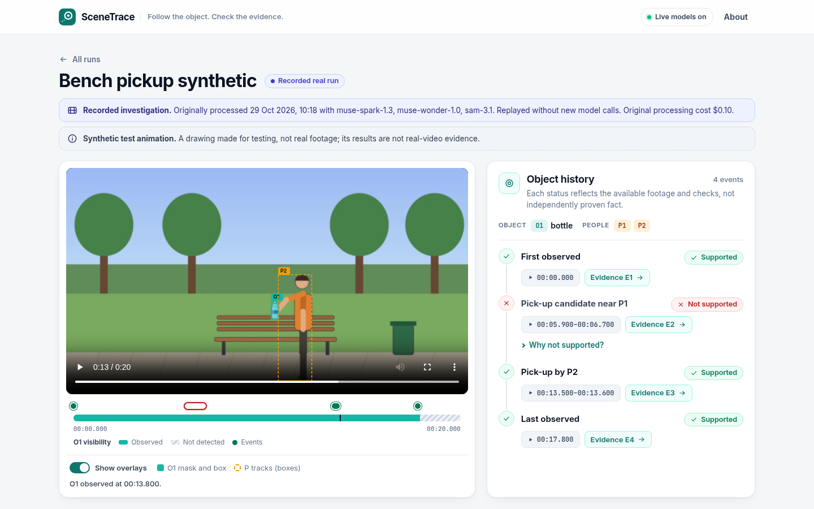
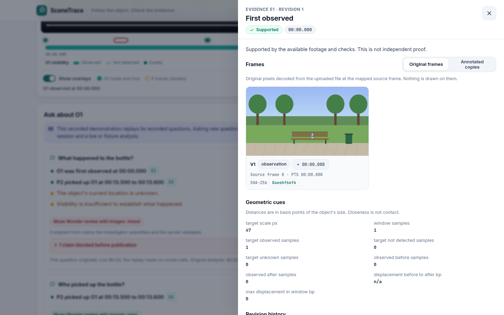
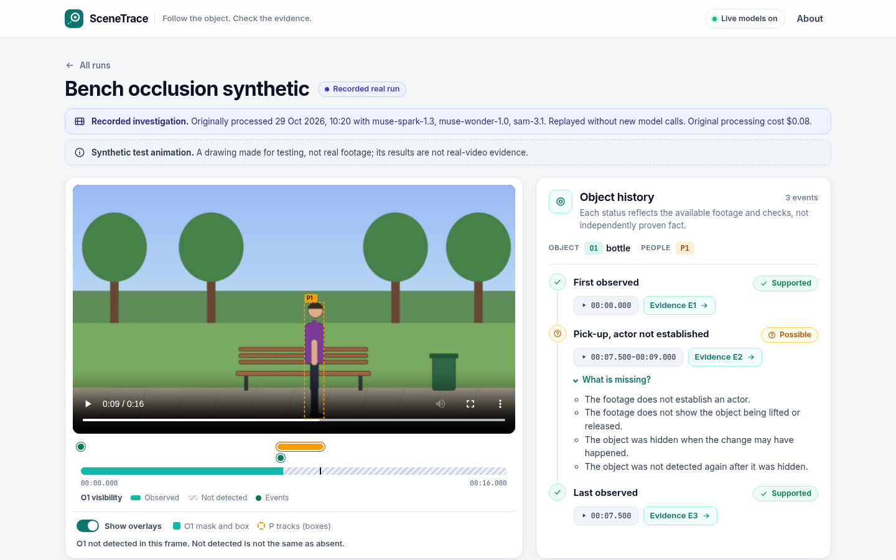
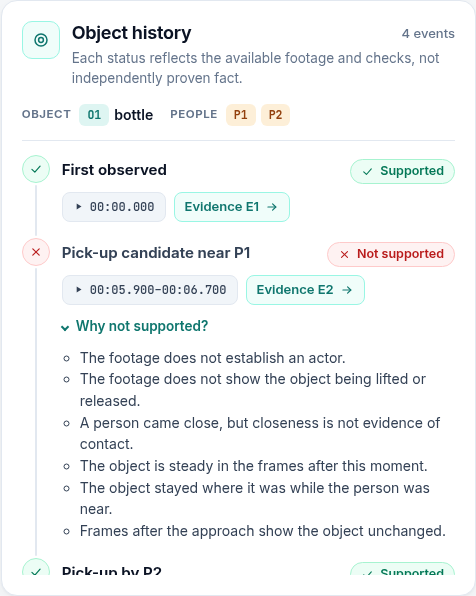
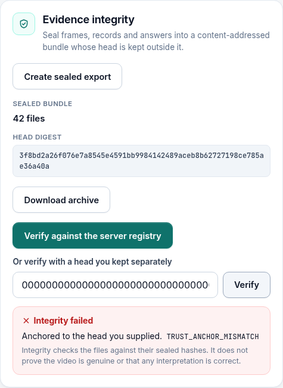

# SceneTrace

**Follow the object. Check the evidence.**

Created by **Isaac Oselukwue**.

SceneTrace reconstructs the observed history of one selected object in a short, fixed-camera video, answers questions about it, and links every factual statement to the original frames behind it. When the footage does not show what happened, it says so instead of filling the gap with a fluent story.

It is built on Meta Model API: **SAM 3.1** segments and tracks the object and the people near it, **Muse Spark 1.3** assesses candidate interactions from the original frames and runs a bounded investigation, and **Muse Wonder 1.0** can review the final claims against the evidence in a fresh context.



## Demonstration

[Watch the 3-minute demonstration (docs/media/scenetrace-demo.mp4)](docs/media/scenetrace-demo.mp4). It is a screen recording of the running application, including a live analysis and a live question against Meta Model API; waiting time during those two live calls is shown at 2x speed and labelled on screen. The clips are drawn test animations, not real footage.

| | |
| --- | --- |
|  |  |
| Every cited statement opens the original frames before, during and after. | A removal hidden behind a person stays possible, with no actor named. |
|  |  |
| A pass-by is stored and explained, not counted. | Sealed evidence fails verification against a different head. |

## Why it is different

A model that watches a video will happily say who took something. SceneTrace is built so that it cannot do that without evidence:

- **Geometry proposes, evidence decides.** Tracks generate candidate moments; Muse Spark assesses each one from six original frames (two before, two during, two after); deterministic rules decide the status. A person walking past a bottle is stored as a *rejected* candidate, and the interface shows why.
- **No model prose reaches the answer.** The investigator can only submit structured claims. The server checks every claim against the exact stored event revision (object, action, actor, time, zone, certainty), checks that the evidence bytes still match their digests, and then writes the sentence itself.
- **Unknown stays unknown.** A missing detection is "not detected", not "absent". A removal hidden behind a person becomes a *possible* event with no actor, never a confident accusation.
- **Every paid call is reserved first.** A durable ledger reserves the worst-case cost of each SAM and Muse call (image token counts are measured before dispatch) and records provider-reported usage afterwards.
- **Evidence can be sealed and checked.** An export is a content-addressed bundle whose expected head is kept outside the bundle, so a byte change or a coherent rewrite is detected.

## What works

| Flow | Status |
| --- | --- |
| Upload an MP4/MOV (150 MB, 90 s caps), normalise to an exact 10 fps proxy with a source frame map | Working, tested |
| Select the object by phrase (SAM finds candidates; you choose if several match) or by drawing a box | Working, live and fixture |
| Live tracking of the object (box-seeded SAM 3.1) and people (concept `person`), with coverage states | Working against Meta Model API |
| Candidate engine: pick-up, put-down, placement in a drawn zone, pass-by and hidden-removal candidates | Working, tested on synthetic trajectories and real SAM output |
| Muse Spark structured assessment of each candidate from original frames | Working against Meta Model API |
| Questions answered by a bounded investigator (6 turns, 8 tool calls, 2 extra inspections, 1 repair) | Working against Meta Model API |
| Optional Muse Wonder secondary review with images; it can block claims, never promote them | Working against Meta Model API |
| Evidence drawer: original and annotated frames, source frame and timestamp, digests, assessments | Working |
| Sealed export, download, verification against the server registry or a head you kept | Working |
| Recorded demonstrations replayed through the same pipeline with no network and no model calls | Working, including in Docker |
| Phone layout (390 px), keyboard focus, reduced motion | Working, browser-tested |

Run modes are always labelled: **Live analysis**, **Recorded real run** (a replay of a stored live run, with its original date, models and cost) and **Development fixture** (deterministic code stands in for the models; a persistent banner says it is not a real analysis).

## Results

All figures below come from `make evaluate` (see [reports/SUMMARY.md](reports/SUMMARY.md)). They are kept separate on purpose.

**Real-video evaluation: not yet measured.** No owned, consented, labelled real clips have been recorded yet, so there is no real-video accuracy figure. The labelling workflow is ready (see *Evaluating on your own footage*).

**Synthetic smoke check (not real-video evidence).** Two drawn test animations (a pickup with a pass-by, and a removal hidden behind a person), scored against the renderer's ground truth using the recorded live model outputs:

| Arm | TP | FP | FN |
| --- | ---: | ---: | ---: |
| Full system (supported events only) | 1 | 0 | 0 |
| Geometry only (no visual assessment) | 1 | 1 | 0 |

The geometry-only arm turns the hidden removal into a pickup; the full system keeps it as a possible event with no actor. Actor attribution: 1 correct of 1 matched observable event, 0 wrong confident assignments. The unobservable question ("Who took the bottle?") was correctly answered with an abstention. With two drawn clips this is a smoke check, not a benchmark.

**Planted faults.** 30 deliberately corrupted claims (actor substitution, time substitution, wrong predicate or citation, nonexistent event, certainty escalation, stale revision; five each) and 10 clean controls, built from the recorded live run records:

| Layer | Faults caught | Clean claims wrongly blocked |
| --- | ---: | ---: |
| Deterministic validator | 30 / 30 | 0 / 10 |
| Muse Wonder reviewer alone (live, images) | 22 / 30 | 3 / 10 |
| Both | 30 / 30 | 3 / 10 |

The reviewer misses changes it cannot see (one-second time shifts, superseded revisions) and is cautious with some true claims, which is why it is a secondary check and never the gate.

**Cost and latency** (original live runs of the two synthetic clips, provider-reported usage at the dated rate card): cold analysis n=2, median 32.9 s (25.4 to 40.4 s), median USD 0.089; questions n=5, median 18.3 s (8.5 to 31.6 s), median USD 0.041.

**Failure example.** In the recorded hidden-removal run, Muse Wonder asked for more evidence on the last-sighting claim, so "Where was the bottle last seen?" was answered only with uncertainty messages, although the sighting itself was supported.

**Software checks.** 72 Python tests pass (2 opt-in live tests skipped by default), plus 53 tests of the core claim, budget and integrity modules, 7 client unit tests and 7 browser tests. A live capability check against Meta Model API passed all 10 checks on 28 October 2026 ([reports/provider-capabilities.json](reports/provider-capabilities.json)).

## Run it

Prerequisites: Python 3.12 with [uv](https://docs.astral.sh/uv/), Node.js 22, FFmpeg on `PATH`, and Google Chrome for the browser tests.

```bash
make bootstrap          # locked Python and client dependencies
make demo               # recorded runs at http://127.0.0.1:8765, no key and no model calls
```

Live analysis spends money on Meta Model API within the configured caps (USD 1.50 per analysis, 0.25 per question, 20 per day by default):

```bash
cp .env.example .env    # set MODEL_API_KEY and SCENETRACE_ENABLE_LIVE_UPLOADS=true
cd client && npm run build && cd ..
.venv/bin/python -m scenetrace serve          # http://127.0.0.1:8765
```

Other commands: `make dev` (API plus Vite dev server), `make test`, `make test-ui`, `make test-live` (opt-in, spends money), `make evaluate`, `make check` (lint, types, tests, schema drift, secret scan) and `make build`. With Docker, `docker compose up --build` runs one process with a persistent volume and imports the recorded runs. Without an access code it serves recorded runs to everyone and allows uploads only to an owner signed in with `SCENETRACE_DEMO_ACCESS_CODE`.

## How it works

```text
Browser (React, TypeScript)  ──same origin──  FastAPI process
                                               ├─ upload, ffprobe checks, exact 10 fps proxy and frame map (FFmpeg)
                                               ├─ SQLite (WAL): jobs, events, ledger, revisions, exports
                                               ├─ one bounded worker: cold analysis and questions
                                               ├─ SAM 3.1 adapter (meta-sam-parser) ─┐
                                               ├─ Muse Spark / Muse Wonder adapters ─┴─ Meta Model API
                                               ├─ candidate engine, evidence frames, promotion rules
                                               ├─ investigator, claim compiler, secondary review
                                               └─ sealed exports and recorded-run replay
```

Cold analysis runs once per selected object: normalise, resolve the target, track the object and people, generate candidates, extract evidence frames from the original upload, assess, and append event revisions. Questions then read those immutable records; the investigator may request at most two extra inspections, and every answer records the event revisions it used. Recording and replay happen at the transport layer, so a recorded run executes the same code as a live one, and image requests are matched by decoded pixels so replays survive different FFmpeg builds.

## Evaluating on your own footage

1. Record short fixed-camera clips with consenting participants (a visible pickup, a pass-by, a hidden change, a different object and scene, an object that leaves and returns).
2. Copy `eval/labels/example.label.json.template` to `eval/labels/<clip>.label.json`, fill in the source SHA-256, events, visible actors and questions before running anything, and mark held-out clips `"split": "held_out"`.
3. Run a live analysis of each clip and ask the labelled questions, then `make evaluate`. Development clips never count towards held-out results.

## Limitations and privacy

- Short clips (up to 90 s), a fixed camera, one selected object, and at most six people. No moving cameras, crowds or long footage.
- P1 and P2 are clip-local tracks, not identified people. There is no face recognition, identity linking or demographic inference, and identity is not assumed across gaps or exits.
- "Supported" means supported by the available footage and checks. It is not proof of intent, guilt or ownership, and an integrity check does not prove that a video is genuine.
- Live mode sends the normalised clip and selected frames to Meta Model API in Standard mode; uploaded provider files are deleted after each run, and local uploads expire after 24 hours. Use only footage you own and have permission to analyse.
- The real-video accuracy of the system is not yet measured.

## Built during the hackathon

Everything in this repository was created for the Meta Global AI Developer Hackathon, between 28 and 29 October 2026: the ingestion and frame mapping, SAM and Muse adapters, candidate engine, investigator, claim compiler, ledger, API, worker, client, exports, replay, evaluation harness, tests, synthetic test clips and recorded runs. The commit history records the build.

**Used, not built:** Meta Model API with SAM 3.1, Muse Spark 1.3 and Muse Wonder 1.0; Meta's `meta-sam-parser` (SAM License); React (MIT); FastAPI, Starlette, Pydantic, HTTPX, Uvicorn, NumPy, Pillow, jsonschema, python-multipart; Vite, Vitest, Playwright, openapi-typescript; FFmpeg. See [THIRD_PARTY_NOTICES.md](THIRD_PARTY_NOTICES.md).

## Integrity

Download a sealed export, extract it into a new empty directory, and verify it against the head you recorded separately when it was created:

```bash
.venv/bin/python -m scenetrace verify <extracted-bundle> --expected-head <64-hex-digest>
```

Without a separately kept head, a valid result only shows internal consistency.

## Ownership and licence

Project creator and owner: Isaac Oselukwue. Copyright (c) 2026 Isaac Oselukwue. A licence for this repository has not yet been chosen, so no reuse rights are granted beyond viewing. Third-party components keep their own licences.
